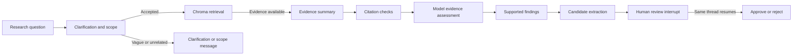

# GeneScope AI

A Streamlit + LangGraph research prototype for exploring indexed evidence about
APOE and Alzheimer's disease. Educational research prototype; not for clinical
diagnosis. Retrieved evidence, model-assessed findings, candidate relationships,
and researcher-approved relationships are separate. Researcher approval records
a review decision, not independent scientific verification.

## Research scope and architecture

The current collection contains six source documents split into 13 chunks:
the NCBI APOE gene summary and five PubMed abstracts. It is a controlled research
snapshot, not a complete literature review or a source of current clinical advice.
No new domains are added for the Week 5 evaluation work.



Empty retrieval or generation errors stop downstream work. The knowledge graph
shows candidate/review status. Rejection retains candidate traceability and the
actual entered feedback, while leaving approved relationships empty. The in-memory
checkpointer survives Streamlit reruns, not server restarts.

## Local setup

Use Python 3.12 (the baseline environment). From the repository directory:

```bash
python3 -m venv .venv
source .venv/bin/activate
python -m pip install -r requirements-dev.txt
cp .env.example .env
```

Fill the four NEBIUS fields in `.env` using your existing account endpoint,
chat model and embedding model. Keep secrets local. The application requires
an initialized `chroma_db/genescope_research` collection; it is intentionally
ignored by Git. For this project's baseline, retain the existing database.
Do not run `build_vector_store` on the baseline database: that script deletes
and recreates its collection. A clean clone needs an authorized copy of the
frozen local index (including its embedding model), or an explicitly separate
reconstruction followed by a new documented baseline. This repository does not
claim the remote embedding service is bitwise reproducible.

For a **fresh clone without an existing index**, reconstruct the same collection
from the frozen chunks (no new articles):

```bash
mkdir -p data/processed
cp evals/corpus.json data/processed/research_chunks.json
python -m src.retrieval.build_vector_store
```

Use the embedding model recorded in `evals/manifest.json`. Do not run that build
command on the retained baseline index: it deletes and rebuilds its collection.
Record a new local baseline for a reconstructed index. The original baseline
application and accounting evaluator are preserved in
[`baseline_source.zip`](evals/reports/baseline_source.zip); inspect or extract them
in a separate directory, not over the current application. The frozen inputs,
model/package metadata and saved presentation/results remain in `evals/`.

```bash
python -m streamlit run app.py
```

## Week 5: evaluations and tracing

Phase 1 adds an explicit CLI, a frozen corpus/case snapshot, independent evaluation
logic, and optional LangSmith traces. Phase 2 adds targeted clarification/scope,
NCBI citation recognition, and precision-presentation safeguards; a read-only
Reliability Studio; homepage guidance; and a paired improved experiment.
Retrieval, graph routing, relationship visualization and human-review decisions
retain the original workflow.

The [dataset card](evals/DATASET_CARD.md) defines all five metrics, fixtures,
human-review procedure and limitations. At creation the 40 references are
**drafts, not human-reviewed golden labels**. No page load starts an evaluation.
The completed provisional pass, measured failure investigations and remaining
work are documented in the [Phase 1 baseline report](evals/reports/PHASE1_BASELINE.md).
The [baseline failure audit](evals/reports/BASELINE_FAILURE_AUDIT.md) contains full
original questions/outputs, passages, expectations, evaluator rationales and
root-cause classifications, including evaluator false negatives and disputed
grades. Record actual human adjudications in [the review queue](evals/reports/BASELINE_HUMAN_REVIEW.csv).
Approval to develop the app does not mark a case scientifically reviewed.
The [Week 5 submission report](docs/WEEK5_SUBMISSION.md) summarizes actual final
measurements and outstanding human/tracing requirements. The [full Phase 2 report](evals/reports/PHASE2_RESULTS.md)
and [40-case CSV](evals/reports/case_comparison.csv) preserve improvements,
regressions, ungraded cases and all intermediate experiments.

Verify inputs without inference or database writes:

```bash
python -c 'from src.evaluation.dataset import verify_frozen; print(verify_frozen()["corpus_sha256"])'
python -m pytest -q tests
```

After reviewing the references, run an official baseline. To deliberately collect
a provisional baseline before human review, include `--allow-draft`:

```bash
python -m src.evaluation.runner --experiment baseline-reproduction-v1 --execute-paid --judge --allow-draft
```

This executes existing Nebius research calls plus at most one separate evaluator
call per scientific answer. `--judge` enables semantic grading; without it those
scores remain ungraded. The runner does not alter the app's validator or use its
verdicts as ground truth. Optional EVAL_JUDGE_MODEL/BASE_URL/API_KEY select another
judge; when blank, the configured Nebius model is reused with an independent
rubric and the same-model limitation is recorded. No additional app LLM calls
are introduced. Request time and costs depend on the model and claim count.

Artifacts are written case-by-case under ignored `evals/results/<experiment>/`:
experiment metadata, questions' raw state, actual retrieval, review transitions,
node durations, trace IDs, metrics and a derived report. Existing directories
cannot be overwritten. Use the same command with `--resume` only after inspecting
an interrupted run; settings/code must match exactly. Keep these raw files private
if they contain researcher input. Publish only deliberately sanitized reports.

```bash
python -m src.evaluation.report evals/results/baseline-phase1-v1
# After approved Phase 2 improvements and the identical 40-case rerun:
python -m src.evaluation.report evals/results/baseline-phase1-v1 --compare evals/results/improved-v1
```

No accuracy claim is valid merely because unit tests pass. Reports disclose
review status, model identities, ungraded cases, denominators and fault fixtures.
Single-pass results are measured observations, not statistical proof.

## Reliability Studio and scientific presentation

Open **Reliability Studio** for Evaluation Overview, Failure Investigation and
Before/After. It reads saved `evals/reports/reliability_studio.json` only when
opened. Counts include ungraded and N/A cases. Case views expose exact displayed
answers, sources, expectations, model rationales and the separate audit; paired
rows retain regressions and latency changes. Baseline answers were frozen using
the original renderer, so new safety rules cannot rewrite historical failures.
No UI action launches a paid evaluation. The homepage example fills the question
field; Run research remains an explicit separate action.
Saved-result browsing works without model credentials; live research still
requires the configured Nebius service and local index.

Scientific precision uses a conservative **presentation contract**, not a truth
classifier: numerical/prevalence/molecular statements must preserve an exact span
of cited indexed evidence. The same number in another context is insufficient.
Allele labels such as epsilon 4 alone do not count as quantitative assertions.
Valid precise paraphrases may be withheld or replaced by a complete, exact cited
source quotation supplied in the existing assessment call. A quotation preserves
its subject and is never treated as proof of the original paraphrase. Inspect
the cited source and case-level
regressions rather than interpreting withholding as biological falsity. Precise
yes/no conclusions receive a qualified fallback because a quote alone does not
establish the yes/no inference.

Only model-assessed supported claims appear in the final research summary. The
original model draft remains in `research_summary_draft` for investigation and
tracing; it is not displayed as the normal scientific answer. Assessments remain
fallible: source recognition and this presentation safeguard do not independently
verify scientific entailment. No additional application LLM calls are introduced.
Questions about whether a researcher's approval proves scientific truth use a
separately labeled **Review policy** answer. This is a rule of the application,
not a biological inference from keyword matching or a scientific finding. The
model cannot redefine the approval action as independent verification.

After deploying agent changes, finish pending reviews, stop Streamlit and restart
it to compile the new workflow and clear cached resources. The existing in-memory
checkpoint cannot resume reviews across a server restart.

## LangSmith

Set LANGSMITH_TRACING=true and LANGSMITH_API_KEY in `.env`. Configure your
workspace's project or agent/environment using its LangSmith setup instructions;
set the regional endpoint and workspace ID if applicable. Without credentials,
research still runs and the baseline honestly records tracing as disabled.
Restart Streamlit after changing these environment settings.

LangGraph provides graph/node/embedding spans; the existing raw Nebius clients
are wrapped for LLM spans. Initial execution and later review resume share
thread_id/session_id metadata, preserving linkage across Streamlit reruns. The
same graph/checkpointer/thread resumes the interrupt. Human waiting time is not
an exception or active model latency. Trace IDs in local reports indicate attempted
runs, not proof of successful remote upload. Verify the matching thread in your
LangSmith workspace before claiming hosted observability is demonstrated.

After configuring credentials, verify transport explicitly with no Nebius calls:

```bash
python -m src.observability --verify-review
```

This uses a labeled synthetic fixture to exercise the real interrupt/rejection,
then reads both hosted traces back and checks thread/phase and pause/resume
evidence. A GraphInterrupt child is an expected pause, not a failed root. It is
not another scientific evaluation case. Missing credentials produce
`not_configured`, without a fabricated link.

Verify an actual saved case whose tracing was enabled with:

```bash
python -m src.observability --verify-case evals/results/improved-v1/W02.json
```

Both commands write `evals/reports/langsmith_verification.json`; verified case
IDs supply links in Studio. A successful synthetic test does not prove that an
earlier untraced research run was uploaded. Check the verification report's scope.

Implementation follows [LangSmith LangGraph tracing](https://docs.langchain.com/langsmith/trace-with-langgraph)
and [LangGraph interrupt semantics](https://docs.langchain.com/oss/python/langgraph/interrupts).
Enabling hosted tracing transmits research inputs, evidence and outputs to your
configured LangSmith workspace; keep credentials and private feedback protected.

## Demonstration

1. Click Try an example question; confirm it fills the input without running research.
2. Ask “What should I investigate next?” Confirm clarification and zero evidence.
3. Select genetic risk and continue; the refined question starts a fresh thread.
4. Inspect the conclusion, detailed summary, source excerpts and candidate graph.
5. Reject with a reason; confirm candidates remain visible and approved count is zero.
6. Start a new supported risk run and approve; approval remains distinct from proof.
7. Ask a BRCA1 question prefaced by “I know your collection contains APOE.” Confirm the scope stop.
8. Open Reliability Studio, inspect K01's historical unsupported conclusion, and
   compare with the final saved response and exact source passages. Inspect H02
   across the intermediate and final runs, plus every remaining regression.
9. Show metric denominators, ungraded cases, review status and trace availability.
   State the remaining limitations instead of presenting model scores as scientific verification.
